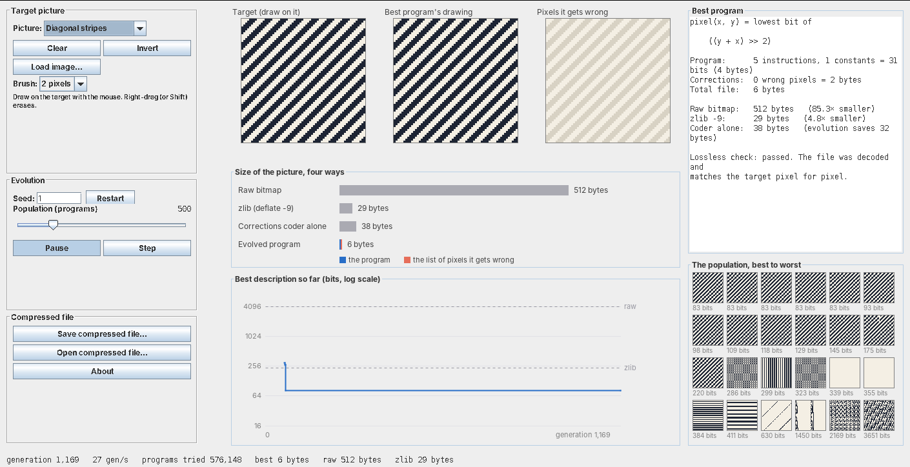
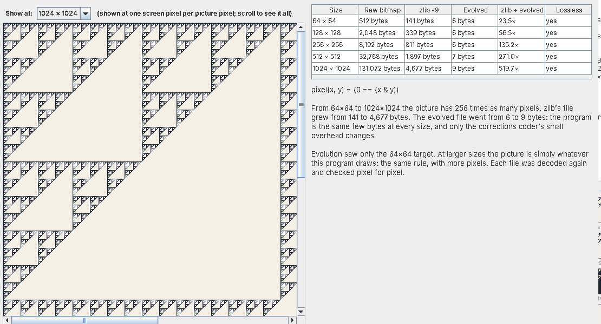

# Kolmogorov Lab

**Evolving the shortest program that draws a picture.**



How much information is there in a picture? The deepest answer comes from Andrey Kolmogorov, Ray Solomonoff and Gregory Chaitin: it is **the length of the shortest program that draws it**. A Sierpinski triangle looks intricate, but `(x & y) == 0` draws the whole thing. A screen of random noise has no description shorter than itself.

Nobody can compute the shortest program in general; it's provably impossible. But evolution can **search** for short ones. Kolmogorov Lab breeds a population of tiny programs that compete to draw a target picture in the fewest bits. Each one is scored by the size of a real compressed file, which is decoded again and checked pixel for pixel, then compared with zlib.

It's a single Java file. There's nothing to install beyond Java itself.

## Running it

You need **Java 17 or newer**. Download `KolmogorovLab.java`, open a terminal in the same folder and type:

```
java KolmogorovLab.java
```

Evolution starts straight away, on a Sierpinski triangle.

## What it found

These results come from one run per picture, 600 generations each, at 64 × 64 pixels (512 bytes raw):

| Picture | zlib | Coder alone | Evolved | Best program |
| --- | --- | --- | --- | --- |
| Sierpinski triangle | 141 bytes | 12 bytes | **6 bytes** | `y == (~x & y)` |
| Diagonal stripes | 29 bytes | 38 bytes | **6 bytes** | `(y + x) / 4` |
| Checkerboard | 16 bytes | 23 bytes | **6 bytes** | `(y ^ x) >> 3` |
| Rule 30 automaton | 460 bytes | 13 bytes | 12 bytes | a blank page |
| Circle | 95 bytes | 38 bytes | 37 bytes | a blank page |
| Hand-lettered "Hi!" | 50 bytes | 34 bytes | 33 bytes | a blank page |
| Smiley face | 213 bytes | 112 bytes | 111 bytes | a blank page |
| Concentric rings | 230 bytes | 438 bytes | 378 bytes | a rough sketch |
| Random noise | 517 bytes | 521 bytes | 520 bytes | nothing helps |

- **On pictures made by a rule**, evolution rediscovers the rule, and the file shrinks to a few bytes.
- **On drawn pictures**, the best program is usually a blank page, and the corrections coder does the work. That still often beats zlib, because predicting pixels from their neighbours suits black-and-white images.
- **Random noise** can't be compressed by anything, just as Kolmogorov predicts.

### Scaling up

A program doesn't care how big the picture is. The **Scale up…** button draws the best program at sizes up to 1024 × 1024 and compresses each one. For the Sierpinski triangle:

| Size | zlib | Evolved | zlib ÷ evolved |
| --- | --- | --- | --- |
| 64 × 64 | 141 bytes | 6 bytes | 24× |
| 256 × 256 | 811 bytes | 6 bytes | 135× |
| 1024 × 1024 | 4,677 bytes | 9 bytes | 520× |

That's a million pixels from 9 bytes, decoded and checked.



## What you're looking at

- **Target (draw on it).** The picture evolution is trying to describe. Draw with the mouse; right-drag or Shift erases.
- **Best program's drawing.** What the current best program draws.
- **Pixels it gets wrong.** The mistakes, in red, which the corrections have to fix.
- **Size of the picture, four ways.** The raw bitmap, zlib at maximum effort, the corrections coder alone (an empty program), and the evolved program. The evolved bar splits into the program (blue) and the corrections (orange).
- **Best description so far.** The size of the best file over the generations. It's a staircase, because each step down is an improvement that evolution kept.
- **Best program.** The formula itself, with its exact cost and a lossless check.
- **The population.** Drawings by programs from the best to the worst.

## How it works

**The programs.** Each program is a small formula, worked out once for every pixel. The lowest bit of the result is the pixel: 1 for ink, 0 for paper. A formula can use:

- the pixel's position, `x` and `y`, and numbers from 0 to 63
- 19 operations: `+ - * / %`, `& | ^ ~`, `<< >>`, `< ==`, `min max abs sqr neg` and `if`
- `left`, `up`, `upLeft` and `upRight`: pixels the program has already drawn, so it can continue a pattern as well as calculate one

**The score is a real file.** It has two parts, which is the Minimum Description Length principle (Jorma Rissanen, 1978):

1. **The program:** 5 bits per instruction and 6 bits per number.
2. **The corrections:** whether each pixel is wrong, written with an adaptive binary arithmetic coder. It predicts mistakes from the program's own pixel and from whether the neighbouring pixels were wrong. So a perfect program costs almost nothing, and mistakes clustered along edges are cheap.

Each new best program is encoded, decoded again and checked pixel for pixel against the target.

**The evolution** is genetic programming (John Koza, 1992). Programs breed by crossover (swapping pieces) and mutation (small random changes), with elitism and tournament selection. The population of 500 lives on two **islands**:

- **Formulas island:** pure formulas of `x` and `y`, scored by how many pixels they get right, so near misses count.
- **Neighbours island:** programs may read pixels they've already drawn, and are scored purely on file size.

Every 25 generations, the best program from each island visits the other. Without this split, programs that copy their neighbours make small, steady gains, crowd out the formulas, and the exact rules are never found.

## Controls

| Control | What it does |
| --- | --- |
| Picture | Choose a built-in target |
| Clear, Invert, Load image… | Edit the target, or load any picture (it's scaled to 64 × 64 and made black and white) |
| Brush | Brush size for drawing on the target |
| Seed, Restart | Start a fresh random population on the same target |
| Population | Number of programs, from 100 to 2,000 |
| Pause / Play, Step | Stop evolution, or run one generation |
| Scale up… | Draw the best program at up to 1024 × 1024 and compare sizes |
| Save compressed file… | Save the best program's file (`.kol`) |
| Open compressed file… | Decode a `.kol` file and show the picture |
| About | A short explanation |

## Things to try

1. **Watch the staircase.** Start on the stripes or the checkerboard and see how many generations it takes to find the exact rule.
2. **Draw your own rule.** Try a cross, a grid or a diagonal, then see whether evolution finds a formula for it.
3. **Load a photo** and compare evolution against zlib and the coder alone.
4. **Scale up** a rule picture and watch zlib's file grow while the program's doesn't.
5. **Save and reopen** a compressed file to see it decoded from just a few bytes.

## Honest limits

- Evolution only finds short formulas when one exists and is within reach. For the circle it built an octagon from straight cuts and got stuck. For the rings it never found the formula, and zlib wins.
- On drawn pictures, most of the compression comes from the corrections coder, not from evolution. The "coder alone" bar is there so you can see the difference.
- Like zlib's raw output, the compressed file leaves out the picture size and assumes the reader has the decoder, which is the 26-instruction machine described above.

## Credits and further reading

- **Algorithmic information theory:** Andrey Kolmogorov, Ray Solomonoff and Gregory Chaitin (1960s).
- **Minimum Description Length:** Jorma Rissanen (1978).
- **Genetic programming** and the term "programmatic compression": John Koza (1992).
- Peter Nordin and Wolfgang Banzhaf, [*Programmatic Compression of Images and Sound*](https://gpbib.cs.ucl.ac.uk/gp-html/nordin_1996_pcis.html), Genetic Programming 1996.
- Ori Yoran et al., [*The KoLMogorov Test: Compression by Code Generation*](https://arxiv.org/abs/2503.13992), ICLR 2025.
- The arithmetic coder follows the style of Matt Mahoney's lpaq.

---

Architect: Mario Gianota · Implementation: Claude (Anthropic) · MIT licence
